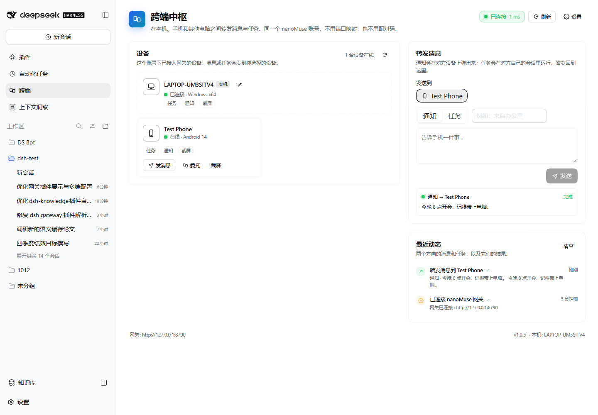
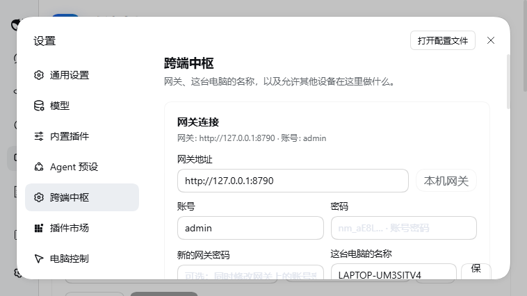

# dsh-plugin-gateway

> 跨端中枢：用同一个 nanoMuse 账号，把 DeepSeek Harness 电脑、手机和其他电脑连成一个设备网。

本插件让 DSH Web 成为一个 **nanoMuse Hub 设备**：



- 通过出站 WebSocket 连接 `nanomuse-gateway`（或任何兼容的中继），不需要开放端口；
- 手机（`nanomuse-mobile`）用同一账号登录后自动出现在设备列表；
- 从网页或 Agent 把 **通知**、**任务** 转发到手机/另一台电脑；
- 手机也可以把任务委托回这台电脑：插件新建标题为「来自 <设备>」的 DSH 会话，运行本机 Agent，把步骤和答案实时回传；
- 所有双向消息落在同一个动态流里，看得见状态和结果。

## 展示方式

插件在 DSH Web 里占三个位置，共用同一套设置和实时状态：

| 位置 | 用途 |
| --- | --- |
| 左侧栏「跨端」图标 + 主面板 | 日常使用：网关状态、设备卡片、转发消息/任务、最近动态 |
| 设置 → 跨端中枢 | 连接表单、设备名、权限开关、本机信息 |
| 插件页 → 本插件行「配置」 | 与设置页相同的配置入口，不用离开插件列表 |

主面板的「转发消息」支持两种模式：

- **通知**：在对方设备弹出提醒，适合「告诉手机…」「提醒电脑…」；
- **任务**：交给对方自己的 Agent 执行，实时显示工具步骤和最终回答。

## 对话内 @设备

在 DSH 对话输入框键入 `@`，候选菜单会出现「在线设备 / 离线设备」分组，列出同一 nanoMuse 账号下的其他设备（显示设备名和 `@handle`）。选中后：

- 输入框里的 `@handle` 会高亮，发送后显示为设备高亮胶囊；
- 消息发送时，Host 半自动把内容投递到对应设备：对方支持 `task` 时交给它的 Agent，否则降级为 `notify`；
- 投递前会剥离目标设备的 `@handle`，避免跨端回环；
- 输入框下方的 Dock 实时显示「投递中 / 已送达 / 部分送达 / 失败」，任务回答也可在 Dock 中看到；
- 设备名中的空格会归一化为 `-`，只保留字母、数字、`_`、`-`，并保证同一账号内唯一。

模型会收到提示：用户消息里的 `@handle` 已由插件自动投递，不要重复调用 `device_send`。

## 配置方式



配置分两层，互不覆盖：

1. **插件行配置**（`cordis.patch.yml` / profile patch）：部署默认值，适合无界面或打包部署；
2. **本机配置** `$DSH_HOME/nanomuse/gateway.json`：API Key、设备 ID、网页里保存的网关地址/账号/设备名/权限。网页保存优先于行默认值，**修改配置不需要重写 profile 或重启**。

```yaml
- insert:
    - id: gateway
      name: dsh-plugin-gateway
      config:
        baseURL: http://127.0.0.1:8790
        identifier: admin
        deviceName: ''
        allowTask: true
        allowNotify: true
        allowScreen: true
        allowOpen: false     # 默认关闭
        allowShell: false    # 默认关闭，高危
```

环境变量 `NANOMUSE_CLOUD_URL` 或 `NANOMUSE_GATEWAY_URL` 可作为地址兜底（优先于行配置，低于网页保存）。

## 连接

1. 启动网关（`nanomuse-gateway`）：

   ```bash
   ./start.sh start          # 默认 127.0.0.1:8790
   ```

2. 在 DSH Web 侧边栏打开「跨端」，输入网关地址、账号、密码，点「保存并连接」。
   - 新账号会自动在网关登记；
   - 可勾选同时修改网关侧密码；
   - 手机 `nanomuse-mobile` 用同一账号登录后会自动出现。

3. 在「设置 → 跨端中枢」里按需打开权限：
   - 接受任务 / 接收提醒 / 允许截屏：常用；
   - 允许打开链接：一般关闭；
   - 允许执行命令：高危，默认关闭。

## Agent 工具

连接后，Agent 会得到当前账号的设备列表，并可使用：

| 工具 | 作用 |
| --- | --- |
| `devices` | 列出账号下的设备、在线状态和能力 |
| `device_send` | 把消息转发到设备：`mode="notify"` 或 `mode="task"` |
| `delegate` | 委托一段自然语言任务并等待回答 |
| `device_notify` / `device_screen` / `device_shell` / `device_open` | 通知、截屏、远程命令、打开链接 |

示例：

```text
帮我把“会议 10 分钟后开始”发到手机上
让 Ubuntu 编译一下项目并把日志发我
手机现在屏幕上是什么？
```

## 本机被远程调用

插件按账号隔离，只响应同一账号的设备；每个动作都有独立开关：

| 动作 | 说明 |
| --- | --- |
| `info` | 返回本机信息和可用动作（始终允许） |
| `notify` | 显示 Web 提示并尽量弹系统通知 |
| `task` | 新建 DSH 会话运行 Agent，流式回传工具/文本/审批事件 |
| `screen` | 截屏（Windows/macOS） |
| `open` | 打开 http(s) 链接（默认关闭） |
| `shell` | 执行命令（默认关闭） |
| `approve` / `stop` | 远程任务的审批与停止 |

远程任务的审批卡片默认发回发起设备，由发起者在手机上确认；可在设置中关闭。

## 协议

与 `nanoMuse` Hub 协议一致（`docs/zh/hub.md`）：

- `GET /v1/gateway/status` 健康探测；
- `POST /v1/auth/credentials` 鉴权（兼容 `/v1/auth/login`）；
- `WS /v1/hub` 全双工中继：`hello` / `welcome` / `devices` / `call` / `event` / `result` / `ping` / `rename`。

## 开发

```bash
node build.mjs        # 生成 index.js / settings.js
dsh --profile web     # 启动 DSH Web
```

插件自有的 HTTP API 位于 `/nanomuse/gateway/*`：

- `GET /config`、`POST /config`
- `POST /test`、`POST /connect`、`POST /disconnect`、`POST /reconnect`
- `GET /snapshot`、`GET /devices`
- `POST /forward`、`POST /device/call`、`POST /device/rename`
- `POST /activity/clear`

`GET /ui` 会重定向回 DSH 首页：界面已经完全并入 DSH Web，不再维护第二套页面。
